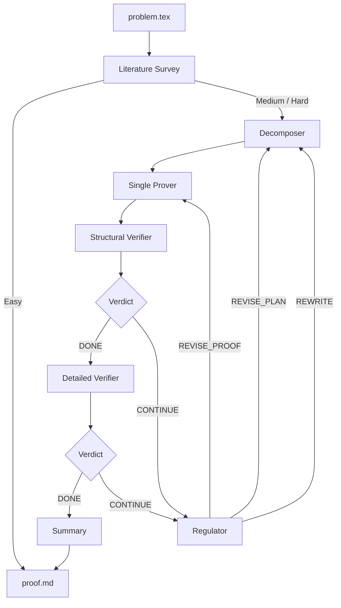

# QED

**Authors:** Chenyang An (<cya.portfolio@gmail.com>) Qihao Ye (<q8ye@ucsd.edu>) Minghao Pan (<mpan2@caltech.edu>) Jiayun Zhang (<landiveo@gmail.com>)

**Paper:** [QED: An Open-Source Multi-Agent System for Generating Mathematical Proofs on Open Problems](https://arxiv.org/abs/2604.24021)

<details>
<summary><b>Citation</b></summary>

```bibtex
@inproceedings{an2026qed,
    title={{QED}: An Open-Source Multi-Agent System for Generating Mathematical Proofs on Open Problems},
    author={Chenyang An and Qihao Ye and Minghao Pan and Jiayun Zhang},
    booktitle={3rd AI for Math Workshop: Toward Self-Evolving Scientific Agents},
    year={2026},
    url={https://openreview.net/forum?id=EPCNlZRUc3}
}
```

</details>

QED is a multi-agent pipeline that takes a mathematical problem statement in LaTeX and produces a rigorous natural-language proof. The pipeline orchestrates Codex (and optionally Claude and Gemini) through their respective CLIs via bash subprocesses (minimal extra dependencies required besides the coding CLI themselves). QED conducts the literature survey, decomposes the problem, executes the plan and verifies the proof. So far, QED has produced 5 works in the area of probabilty, PDE, algebraic geometry and inverse problems that are original and nontrivial according to expert evaluations.

<picture>
  <source media="(prefers-color-scheme: dark)" srcset="https://api.star-history.com/svg?repos=proofQED/QED&type=date&theme=dark&sealed_token=xdfol3Ik3lUq8TNJ73_UIHaIytdiz1R2bitdw_IC6AwHpxre4FD1ddUQd4XHiUB5Z5lbi2g-MEkz20sse5XE0n_31K4sg9RcvTCUU_MrfQ5Zv5JukB28XHTzKs1fUY_mL2j5Xq-Yb6PvMijRFwNIOmtXLenxGBBQh0idHThC3VoWy9BV5smUAyPwc70y" />
  <source media="(prefers-color-scheme: light)" srcset="https://api.star-history.com/svg?repos=proofQED/QED&type=date&sealed_token=xdfol3Ik3lUq8TNJ73_UIHaIytdiz1R2bitdw_IC6AwHpxre4FD1ddUQd4XHiUB5Z5lbi2g-MEkz20sse5XE0n_31K4sg9RcvTCUU_MrfQ5Zv5JukB28XHTzKs1fUY_mL2j5Xq-Yb6PvMijRFwNIOmtXLenxGBBQh0idHThC3VoWy9BV5smUAyPwc70y" />
  
</picture>

## Math Research Problems Solved by QED, Verified by Domain Experts

### 1. Lower Bounds for Advection-Diffusion Equations (PDE / Analysis)

**Domain:** Partial differential equations, advection-diffusion, mixing, fluid dynamics.

**What QED solved:** Explicit lower bounds for advection-diffusion equations across three scenarios: a polynomial bound for inviscid shears, a uniform positive lower bound on the mixing scale for diffusive shears, and an exponential bound for rapidly oscillating time-periodic flows. The proofs were generated entirely by QED without expert human intervention.

**Workflow:** Chenyang An ran QED in decomposition mode.The proof was verified by Professor Xiaoqian Xu.

**Paper:** [Lower Bounds for Advection-Diffusion Equations: An Exploration with AI-Generated Proofs (arXiv:2605.20623)](https://arxiv.org/abs/2605.20623)

**Expert:** Xiaoqian Xu, Assistant Professor of Mathematics at Duke Kunshan University and Zu Chongzhi Center for Mathematics and Computational Sciences.

**Problems and proofs:** [`proved_statements/analysis-May-19-2026/`](proved_statements/analysis-May-19-2026/)

<details>
<summary><b>Expert comment (Xiaoqian Xu)</b></summary>

This work is comparable to work published at *SIAM Journal on Mathematical Analysis* (SIMA) or *Journal of Differential Equations* (JDE) or higher.

The paper captures three typical scenarios a human researcher might face:

1. **Section 2 (polynomial bound for inviscid shears):** This shows that AI is good at handling prove-or-disprove problems. If one direction is not that hard, AI may be able to solve it. This is quite different from human researchers.

2. **Section 3 (diffusive shears):** Given results from humans, AI can easily fill in the gaps and optimize the constants. This illustrates universally useful ways of using AI.

3. **Section 4 (oscillating flows):** This is remarkable. The problem itself is intuitive, but solving it would mean spending months learning Floquet theory—painful for someone not versed in functional analysis. AI solved it nicely. The proof is standard, but what's hard is the combination of standard techniques from quite different fields—a common scenario for human researchers, particularly when training students.

**On AI capability:** This shows that the lower bound for AI (since there is almost no cost in human effort, like learning or thinking) is already quite high. It may suggest that mathematics under a certain level—a level that we cannot even call medium for average mathematicians—should be seen as trivial.

See the [full expert comments](proved_statements/analysis-May-19-2026/README.md#expert-comments) for complete details.

</details>

---

### 2. Local Invariant Cycle Theorem over Integers for $H^1$ (Algebraic Geometry)

**Domain:** Algebraic geometry, Hodge theory, monodromy, cohomology of degenerations.

**What QED solved:** The invariant cycle theorem (Clemens-Schmid, 1970s) states that for a semistable family of complex projective varieties, the invariant class on a nearby smooth fiber extends to the total space. This was known over $\mathbb{Q}$ but open over $\mathbb{Z}$. In February 2026, Arapura-Greer-Zhang showed the integral version fails for $H^2$. QED proved that the integral version **holds for $H^1$**: for a one-parameter family $X \to B$ over a disk with simple normal crossing central fiber, the restriction map $H^1(X, \mathbb{Z}) \to H^1(X_t, \mathbb{Z})^T$ to the monodromy-invariant submodule is surjective. **AI's proof (April 25, 2026) was produced before the human proof was released on public (May 15, 2026 in the paper [arXiv:2602.07302](https://arxiv.org/abs/2602.07302)), but is after the time when the human proof was found. AI's work is independent and mathematically different from human experts' proof.** This problem statement is regarded as moderate difficult by the expert.

**Expert:** Yilong Zhang, Limited Term Assistant Professor in the Department of Mathematics at the University of Georgia,one of the authors of [arXiv:2602.07302](https://arxiv.org/abs/2602.07302).

**Workflow:** Chenyang An ran QED in decomposition mode. QED produced the proof through 1 plan, 2 revisions, and 7 attempted proofs in total. The proof was verified by Professor Yilong Zhang.

**Problems and proofs:** [`proved_statements/algberaicgeometry-May-17-2026/`](proved_statements/algberaicgeometry-May-17-2026/)

<details>
<summary><b>Expert comment (Yilong Zhang)</b></summary>

"The method in AI's proof that interprets the coboundary map $H^1(X^*) \to H^2(X, X^*)$ as the residue map is **original**. This actually holds in higher degrees by working with Griffiths' residue, but in degree one, this interpretation is the classical residue and is particularly useful for LICT$_\mathbb{Z}$, since one has the key lemma which is essential in the proof."

"The proof is **elementary and elegant**. (The first lemma is essentially residue theory in complex analysis, and the second is essentially reduced to Picard-Lefschetz theory for curves.) It provides a different point of view on the integral version of the invariant cycle theorem in degree one."

See the [full expert comments](proved_statements/algberaicgeometry-May-17-2026/README.md#expert-comments-from-professor-yilong-zhang) for complete details.

</details>

---

### 3. Return Probability Asymptotics for Lamplighter Walk on $\mathbb{Z}_2 \wr T_d$ (Probability Theory)

**Domain:** Probability theory, random walks on groups, lamplighter random walks, spectral analysis.

**What QED solved:** For $d \ge 3$ and the switch–walk–switch lamplighter random walk on $\mathbb{Z}_2 \wr T_d$ (where $T_d$ is the infinite $d$-regular tree), QED proved the sharp asymptotic
$$p_{2n}(e,e) = \rho_d^{2n} \exp\!\left[-\bigl(\pi^2(\log(d-1))^2 + o(1)\bigr)\frac{n}{\log^2 n}\right], \quad \rho_d = \frac{2\sqrt{d-1}}{d}.$$
The proof cleverly combines probabilistic constructions with spectral analysis.

**Expert:** Minghao Pan, PhD candidate at Caltech Mathematics Department.

**Workflow:** Minghao Pan provided the problem statement to QED with no further mathematical input. QED ran in decomposition mode and produced the correct proof through multiple rounds of refinement, including substantial changes of proof plan by the decomposition agent. The proof was verified by the expert.

**Paper:** [Return Probability for the Switch–Walk–Switch Lamplighter Walk on a Regular Tree (arXiv:2605.21744)](https://arxiv.org/abs/2605.21744)

**Problems and proofs:** [`proved_statements/prob-May-15-2026/`](proved_statements/prob-May-15-2026/)

<details>
<summary><b>Expert comment (Minghao Pan)</b></summary>

This is a research-level open question in probability theory. Without human mathematical input beyond the problem statement, QED generated a correct proof through multiple rounds of refinement, including substantial changes of proof plan by the decomposition agent. The first result is a solid specialized contribution. Its proof has real mathematical content as it cleverly combines probabilistic constructions with spectral analysis. Its significance appears comparable to work suitable for venues such as the *Electronic Journal of Probability* or *Proceedings of the American Mathematical Society*. The question is in the style of precise probabilistic calculations and estimates.

</details>

---

### 4. Total Variation Asymptotics for Switch-Walk-Switch on $\mathbb{Z}_2 \wr \mathbb{Z}$ (Probability Theory)

**Domain:** Probability theory, random walks on groups, lamplighter random walks, total variation distance.

**What QED solved:** Let $P_t^x$ denote the law at time $t$ of the discrete-time switch-walk-switch walk on $\mathbb{Z}_2 \wr \mathbb{Z}$. For $x=(\mathbf{0},0)$ and $y=(\mathbf{0},2)$, QED proved the asymptotic behavior
$$\|P_t^x - P_t^y\|_{\mathrm{TV}} \asymp t^{-1/2},$$
where $\asymp$ denotes equality up to positive multiplicative constants.

**Expert:** Minghao Pan, PhD candidate at Caltech Mathematics Department.

**Workflow:** Minghao Pan provided the problem statement to QED with no further mathematical input. QED ran in decomposition mode and produced the correct proof through multiple rounds of refinement, including substantial changes of proof plan by the decomposition agent. The proof was verified by the expert.

**Problems and proofs:** [`proved_statements/prob-May-15-2026/`](proved_statements/prob-May-15-2026/)

<details>
<summary><b>Expert comment (Minghao Pan)</b></summary>

This is a technically nontrivial PhD-level problem in probability theory. Without human mathematical input beyond the problem statement, QED generated a correct proof through multiple rounds of refinement, including substantial changes of proof plan by the decomposition agent. The question is in the style of precise probabilistic calculations and estimates.

</details>

---

### 5. Carleman Weight Function Construction (Inverse Problems / PDE)

**Domain:** Inverse problems, Carleman estimates, wave equations on half-infinite domains.

**QED contribution:** An early version of QED identified a characteristic-aligned logarithmic weight with sample parameters through seven search rounds under author-derived screening criteria.

**Paper results:** The authors independently derived the admissible parameter ranges and certified the weight. They proved a global half-line Carleman estimate, weighted conditional lateral Cauchy stability, and a finite-depth semilinear reconstruction result with an endpoint graph stabilizer; they also performed the numerical experiments.

**Experts:** Qiao Zhuang (University of Missouri-Kansas City), Qihao Ye (University of California, San Diego), Zhongqiang Zhang (Worcester Polytechnic Institute), and Yu Wang (Southwest Jiaotong University).

**Paper:** Chenyang An, Yu Wang, Qihao Ye, Zhongqiang Zhang, and Qiao Zhuang (2026). [Carleman Estimates for Wave Equations on the Half-Line: AI-Assisted Weights and Applications (arXiv:2609.06283)](https://arxiv.org/abs/2609.06283). See Appendix A for discovery and Appendix B for author-led parameter analysis.

**Search archive and report:** [Code, prompts, and seven-round records](https://github.com/proofQED/QED_wave_Carleman); [Verification Report — Round 7](https://github.com/proofQED/QED_wave_Carleman/blob/893b18ae7f0a701f40883d4df318c1354a70b903/candidates/winning_report.md). The archived AI-generated report checks simplified search conditions; the paper supplies the final mathematical certification. See the [case notes and BibTeX citations](proved_statements/pde-Mar-23-2026/README.md#citations).

<details>
<summary><b>Expert comment (Qiao Zhuang, Qihao Ye, Zhongqiang Zhang, Yu Wang)</b></summary>

The use of LLM-based search aims to replace the traditional hand-crafted process of identifying suitable Carleman weight functions for deriving Carleman estimates. This process is often difficult, highly problem-dependent, and time-consuming, and may still fail to produce a valid construction through manual trial. By automating the search over admissible weight functions under the required structural and inequality constraints, the approach has the potential to systematically explore viable candidates, thereby reducing reliance on ad hoc intuition and extensive analytical effort. This is particularly important for inverse problems, where the construction of an appropriate Carleman weight is a central and highly nontrivial step that directly impacts stability and uniqueness results. An LLM-assisted search framework can help identify feasible weight structures, guide the design of admissible functions, and accelerate the development of Carleman-based methodologies, thereby extending their applicability to more complex or less structured problems. The contribution produced by QED appears comparable in scope and technical depth to specialized analysis papers published in venues such as Journal of Mathematical Analysis and Applications

</details>


## How It Works

QED takes a LaTeX problem statement, orchestrates multiple LLMs to search for a proof, verifies the proof through multi-phase checking, and iterates until the proof passes or retry limits are exhausted. The final output is a rigorous natural-language proof with citations and a summary of the entire proof effort.

The pipeline runs in three stages: literature survey (Stage 0), the decomposition prover (Stage 1), and the proof-effort summary (Stage 2).

**Easy short-circuit.** During Stage 0, the survey agent classifies the problem as Easy / Medium / Hard. If the classification is **Easy**, the survey agent writes `proof.md` directly and the pipeline exits — Stages 1 and 2 are skipped, so `proof_effort_summary.md`, `summary_log/`, and `decomposition/` are not produced. Medium / Hard problems run all three stages.

## Getting Started

### Prerequisites

| Dependency | Purpose | Install |
|------------|---------|---------|
| Python 3.11+ | Pipeline runtime | [python.org](https://www.python.org/downloads/) or conda |
| `pyyaml` | Config parsing | `pip install pyyaml` |
| [Claude CLI](https://code.claude.com/docs/en/setup) | LLM backend | `curl -fsSL https://claude.ai/install.sh \| bash` (macOS/Linux/WSL) |
| [Codex CLI](https://github.com/openai/codex) | LLM backend | `npm install -g @openai/codex` |
| [Gemini CLI](https://github.com/google-gemini/gemini-cli) | LLM backend | `npm install -g @google/gemini-cli` |
| [DeepSeek Harness](https://github.com/deepseek-ai) (`dsh`) | LLM backend | install the DeepSeek Harness CLI |

You need at least one model CLI installed. Install only the ones you plan to use — every agent role in `config.yaml` can be set to `"claude"`, `"codex"`, `"gemini"`, or `"dsh"`.

The configuration prioritizes capability for mathematical proof search. Model selections were checked against official documentation on **September 22, 2026**:

| Provider | Selected model | Reasoning |
|----------|----------------|-----------|
| Codex | [GPT-6 Astra](https://developers.openai.com/api/docs/models/gpt-6-astra) (`gpt-6-astra`), OpenAI's most capable model | `max` |
| Claude | [Claude Fable 5.1](https://platform.claude.com/docs/en/models/fable-5-1/overview) (`claude-fable-5-1`), Anthropic's choice for the most demanding reasoning | Adaptive thinking; use `CLAUDE_CODE_EFFORT_LEVEL=max` for maximum effort |
| Gemini | [Gemini 3.1 Pro Preview](https://ai.google.dev/gemini-api/docs/models/gemini-3.1-pro-preview) (`gemini-3.1-pro-preview`), selected for complex reasoning | `HIGH` for API access; CLI/model defaults for saved Google login (see subscription track) |
| DeepSeek Harness | `deepseek-flash` (default), `deepseek-chat`, `deepseek-reasoner` | The harness picks the model through its own profile; the `dsh:` section sets the default |

All shipped agent roles use Codex and inherit its global model and reasoning setting. Change an agent's `provider` to use Claude, Gemini or dsh. These are provider-specific choices for this workflow, not a measured ranking on QED's problems. Fable 5.1 requires [Claude Code 2.1.257 or later](https://code.claude.com/docs/en/model-config).

### DeepSeek Harness (`dsh`)

QED drives the DeepSeek Harness through its `headless` profile, which answers
one task and exits:

```bash
dsh --profile headless --json
```

The prompt is passed through **stdin** rather than as a command-line
argument, so there is no length limit on the rendered prompts (they reach
20-30 k characters, which exceeds the Windows command-line cap of 32767).
The harness answers with newline-delimited JSON events; QED reads the
`final` event.

Configure it in the `dsh:` section of `config.yaml`:

```yaml
dsh:
  cli_path: "dsh"
  profile: "headless"
  model: "deepseek-flash"
  permission_mode: "danger-full-access"
  api_key: ""  # or export DEEPSEEK_API_KEY
```

`permission_mode` maps to the harness's own presets: `read-only`,
`workspace-write`, or `danger-full-access`. The proof agents need to write
files in the output directory and run shell commands, which is what
`danger-full-access` grants — the equivalent of Claude's
`--dangerously-skip-permissions`.

### Installation

Clone the repository, then choose **either Python `venv` or Conda**:

```bash
git clone https://github.com/proofQED/QED.git && cd QED
```

**Option A: Python `venv`**

```bash
python3.11 -m venv .venv
source .venv/bin/activate
python -m pip install -r ui/requirements.txt
```

**Option B: Conda**

```bash
conda create -n agent python=3.11 pip -y
conda activate agent
python -m pip install -r ui/requirements.txt
```

For either option, point the launchers at the active environment:

```bash
export QED_PYTHON="$(python -c 'import sys; print(sys.executable)')"
```

In each new terminal or when switching environments, activate your chosen environment (`source .venv/bin/activate` or `conda activate agent`) and repeat the export. This ensures the terminal launchers use the selected environment even when both exist. Without `QED_PYTHON`, `run.sh` and `run_verifier.sh` prefer `.venv/bin/python`, then fall back to the Conda environment `agent`. The UI uses its own Python interpreter unless `QED_PYTHON` overrides it.

Then install the model CLIs you plan to use:

```bash
# Install at least one model CLI; these are separate from Python dependencies.
curl -fsSL https://claude.ai/install.sh | bash  # Claude (macOS/Linux/WSL)
npm install -g @openai/codex               # Codex
npm install -g @google/gemini-cli          # Gemini
```

You can also use an existing Python 3.11+ environment: activate it, install the dependencies, and set `QED_PYTHON` as above.

Before launching QED, complete **[Track 1: API access](#track-1-api-access)** or **[Track 2: Subscription access](#track-2-subscription-access)** below for each model provider you use. Both tracks work with either Python environment and use the same UI, prover, and verifier commands. The default configuration needs only Codex authentication.

### Quick Start (UI Mode — Recommended)

After completing your chosen authentication track, launch QED's Streamlit web UI to edit the problem, configure providers / per-agent models, launch and monitor the pipeline, and stream agent logs from your browser.

```bash
# Launch from your activated venv or Conda environment
python -m streamlit run ui/app.py
```

This opens the app in your browser (default: <http://localhost:8501>). From there:

1. **Edit the problem** — paste your LaTeX problem statement in the *Problem* tab (or point it at an existing `.tex` file).
2. **Pick providers / models** — the *Configuration* tab edits `config.yaml` in place (per-agent provider, model, reasoning effort, etc.).
3. **Run** — hit **Start**. The *Progress* panel shows live indicators for Survey → Decomposition Loop → Summary, with token usage and the latest agent log tail.
4. **Resume** — if a previous run was interrupted, the UI auto-detects prior progress in the output directory and offers to continue from the last checkpoint.

Please don't refresh the page. You will lose the pipeline progress if you refresh.

The UI uses the same `pipeline.py` under the hood, so anything you can configure on the command line is available in the UI.

### Quick Start (Terminal — Alternative)

From your activated venv or Conda environment, with `QED_PYTHON` set as above:

> **First:** write your problem statement in **`problem/problem.tex`** (LaTeX format).

```bash
bash run.sh
```

#### Running on native Windows

The pipeline runs on Windows as well as macOS/Linux. Two things to know:

1. **Git Bash is required.** The entry point is a shell script, so Git for
   Windows (or MSYS2) must be installed. Several programs answer to the
   name `bash.exe` on Windows, and only one of them works here:

   | Path | What it is | Usable |
   |------|------------|--------|
   | `C:\Windows\System32\bash.exe` | WSL launcher stub | no |
   | `%LOCALAPPDATA%\Microsoft\WindowsApps\bash.exe` | WSL App Execution Alias (0-byte reparse point) | no |
   | `...\Git\bin\bash.exe` | Git Bash | **yes** |

   The WSL stubs re-parse a Windows path as a POSIX word, so the
   backslashes are consumed as escapes and the script is looked up under
   a mangled name such as `D:WorkbuddyproofqedQEDrun.sh` — reported as
   `No such file or directory`.

   The UI locates a working shell automatically: it skips the WSL stubs,
   scans the usual Git / MSYS2 / Scoop install locations, and *probes*
   each candidate to confirm it can resolve a Windows path. The sidebar
   shows the resolved shell under **Shell**.

   To override the choice, set `QED_BASH` to the full path of `bash.exe`:

   ```powershell
   setx QED_BASH "C:\Program Files\Git\bin\bash.exe"
   ```

   If Git is installed through Scoop, the path is versioned — use the
   stable `current` symlink:

   ```powershell
   setx QED_BASH "D:\Scoop\apps\git\current\bin\bash.exe"
   ```

2. **Use the Streamlit UI rather than the shell scripts** if you prefer.
   `python -m streamlit run ui/app.py` handles process launch, tree
   termination, path conversion and interpreter detection for you on every
   platform.

From PowerShell or cmd.exe, invoke the script through Git Bash explicitly.
Backslash paths are accepted — the script normalizes them:

```powershell
& "C:\Program Files\Git\bin\bash.exe" "D:\path\to\QED\run.sh"
```

If you keep the shell in Git Bash, use forward slashes (or just `cd` into
the project first and call `bash run.sh`):

```bash
bash /d/path/to/QED/run.sh
```

The scripts detect the interpreter in this order: `$QED_PYTHON`, then
`.venv/bin/python` (macOS/Linux), then `.venv/Scripts/python.exe` (Windows),
then the `agent` Conda environment. A virtual environment in the project
root is therefore picked up without any configuration.

The scripts also avoid depending on Git's coreutils (`dirname`, `cp`) — a
Git Bash launched from PowerShell inherits the Windows `PATH`, which does
not include `/usr/bin`. Any file copying falls back to the Python
interpreter when `cp` is unavailable.

The input file should be a LaTeX problem statement:

```latex
\begin{problem}
Let $f: [0,1] \to \mathbb{R}$ be a continuous function satisfying
$f(0) = f(1) = 0$ and $f(x) > 0$ for all $x \in (0,1)$.
Prove that there exists $c \in (0,1)$ such that
\[
  \frac{f'(c)}{f(c)} = \frac{1}{1-c}.
\]
\end{problem}
```

When the run finishes, your proof is at `<output>/proof.md`. For Medium / Hard problems a summary of the proof effort is also written to `<output>/proof_effort_summary.md`; Easy problems take the short-circuit path described above and skip the summary stage.

### Runtime Checks

Run this from the repository root with your venv or Conda environment activated:

```bash
# Prompt/config checks plus a short live request to each enabled pipeline provider
python code/smoke_test.py --config config.yaml
```

The live check requires authenticated model CLIs and consumes a small amount of model usage. It also runs automatically before `run.sh` starts the proof pipeline. A successful check requires the expected assistant response; CLI error output does not count as success.

## Standalone Proof Verifier

A standalone tool for checking mathematical proofs or problem statements. Two modes:

- **Verify a proof** (default): Takes a problem + proof pair, classifies difficulty as Easy or Hard, then routes through a 1-agent (Easy) or 3-agent (Hard) verification pipeline. Hard problems go through structural verification first, then detailed verification only if structural passes.
- **Review a problem** (`--problem-only`): Takes just a problem statement and checks whether it is well-defined — reports on clarity, consistency, completeness, and soundness.

Supports Claude, Codex, and Gemini. Provider settings are in the `standalone_verifier` section of `config.yaml`.

Use your activated venv or Conda environment with `QED_PYTHON` set as described in Installation.

### Quick Start

**Verify a proof:**

1. Place your problem statement in `standalone_verifier/problem.txt`.
2. Place the proof in `standalone_verifier/proof.txt`.
3. Run:

```bash
bash run_verifier.sh
```

**Review a problem statement only:**

```bash
bash run_verifier.sh problem.txt --problem-only
```

Reports are written to `standalone_verifier_result/`:

| File | When |
|------|------|
| `report.md` | Always — combined final report |
| `structural_report.md` | Hard problems — structural verifier's raw output |
| `detailed_report.md` | Hard problems, structural PASS — detailed verifier's raw output |

### Options

```bash
# Custom input files
bash run_verifier.sh problem.txt proof.txt

# Problem-only review (no proof needed)
bash run_verifier.sh problem.txt --problem-only

# Override provider for all agents
bash run_verifier.sh problem.txt proof.txt --provider gemini

# Override model
bash run_verifier.sh problem.txt proof.txt --provider claude --model claude-fable-5-1
```

## Prover Pipeline

QED runs a structured plan-prove-verify-regulate cycle. A **Decomposer** creates a YAML proof plan (a DAG of intermediate claims), a **Single Prover** executes the plan, two **Verifiers** check the result, and a **Regulator** decides what to do on failure.

**Agents** (each independently configurable to use Claude, Codex, or Gemini):

| Agent | Role |
|-------|------|
| **Decomposer** | Creates a YAML proof plan — a DAG of intermediate claims |
| **Single Prover** | Writes a complete proof following the plan |
| **Structural Verifier** | Checks structure, citations, completeness (phases 1-5) |
| **Detailed Verifier** | Step-by-step mathematical correctness (phase 6) |
| **Regulator** | Analyzes failures and decides the next action |
| **Verdict** | Returns DONE or CONTINUE |

**Three-level retry hierarchy** (controlled by the Regulator):

| Level | When | What happens | Default limit |
|-------|------|--------------|---------------|
| **REVISE_PROOF** | Plan is sound, execution has errors | Re-prove with same plan | 4 per revision |
| **REVISE_PLAN** | Plan has structural gaps | Modify the plan, then re-prove | 4 per attempt |
| **REWRITE** | Fundamental approach is flawed | New decomposition from scratch | 4 total |

When a lower-level limit is exhausted, the system automatically escalates. When all limits are exhausted, the regulator writes a failure analysis for human review.

## Configuration

Choose an authentication track for each provider you use. **Both tracks run through the model CLIs.** API access uses API credentials and provider billing; subscription access reuses a CLI account login and its allowance or usage credits. Model access and limits depend on that account.

The snippets below update the corresponding sections of `config.yaml`; keep the remaining settings. All shipped agents use Codex. To enable Claude or Gemini, change the relevant agent's `provider` and remove incompatible per-agent model overrides, as described under [Per-Agent Model Selection](#per-agent-model-selection).

### Track 1: API access

**Codex / OpenAI API**

Create an API key in the [OpenAI Platform](https://platform.openai.com/api-keys), then authenticate Codex with it:

```bash
export OPENAI_API_KEY="your-openai-api-key"
printenv OPENAI_API_KEY | codex login --with-api-key
codex login status  # Confirm API-key authentication
```

Keep the model configuration below. QED reuses Codex's saved credentials; it does not read an OpenAI API key from `config.yaml`.

```yaml
codex:
  model: "gpt-6-astra"
  reasoning_effort: "max"
```

These calls are billed to your OpenAI Platform account separately from a ChatGPT subscription. See the [official OpenAI authentication documentation](https://learn.chatgpt.com/docs/auth).

**Claude / Anthropic API**

Create a key in the [Claude Console](https://platform.claude.com/) and set:

```yaml
claude:
  provider: "api_key"
  api_key:
    model: "claude-fable-5-1"
    key: "your-anthropic-api-key"
```

QED passes this key to Claude Code as `ANTHROPIC_API_KEY`. In this project, exporting that variable alone is insufficient: the runner clears it before applying `claude.api_key.key`. API usage uses your Anthropic API account. See [Claude Code authentication](https://code.claude.com/docs/en/authentication).

**Gemini API**

Create a key in [Google AI Studio](https://aistudio.google.com/apikey) and set:

```yaml
gemini:
  model: "gemini-3.1-pro-preview"
  thinking_level: "HIGH"
  api_key: "your-gemini-api-key"
```

QED passes this key as `GEMINI_API_KEY`. API quotas and billing apply independently of Google AI subscription access. See [Gemini CLI API-key authentication](https://geminicli.com/docs/get-started/authentication/#use-gemini-api-key).

Claude and Gemini keys entered in `config.yaml` are also included in QED's saved run configuration; keep both the configuration and run outputs private.

**Optional: Claude through AWS Bedrock**

For AWS-billed access, configure credentials, model access, and a supported region in your AWS profile or `AWS_REGION`, following the [Claude Code Bedrock guide](https://code.claude.com/docs/en/amazon-bedrock):

```yaml
claude:
  provider: "bedrock"
  bedrock:
    model: "anthropic.claude-fable-5-1"
    aws_profile: "default"
```

QED sets `CLAUDE_CODE_USE_BEDROCK=1` and `AWS_PROFILE`. Use the Bedrock-specific model ID above for any Claude per-agent overrides too.

### Track 2: Subscription access

**Codex / ChatGPT subscription**

**QED can use GPT-6 Astra through your ChatGPT/Codex subscription without an OpenAI API key**, provided your account and workspace have model access. Sign in through Codex:

```bash
codex login         # Sign in with ChatGPT in the browser
codex login status  # Confirm: Logged in using ChatGPT
```

If switching from a saved API-key login, run `codex logout` before signing in again. Use the same model settings as the API track:

```yaml
codex:
  model: "gpt-6-astra"
  reasoning_effort: "max"
```

The pipeline and standalone verifier both call `codex exec` and reuse that login. Usage follows your Codex allowance and applicable credits. See the [official OpenAI authentication documentation](https://learn.chatgpt.com/docs/auth).

**Claude subscription**

Sign in to Claude Code with your eligible Claude account:

```bash
unset ANTHROPIC_API_KEY
claude
```

Use `/login` to select the subscription account and `/status` to confirm the active authentication. Remove conflicting API or cloud-provider overrides from your shell or Claude settings if needed. Then set:

```yaml
claude:
  provider: "subscription"
  subscription:
    model: "claude-fable-5-1"
```

No Anthropic API key is needed for this route. Fable access depends on your plan and may use paid usage credits; QED's non-interactive calls can consume those credits without an interactive consent prompt. See [Claude authentication](https://code.claude.com/docs/en/authentication) and [Fable usage credits](https://code.claude.com/docs/en/model-config#fable-and-usage-credits).

**Gemini / Google account or subscription**

Start Gemini CLI and select **Sign in with Google**. For Google AI Pro or Ultra, use the account associated with the subscription:

```bash
unset GEMINI_API_KEY GOOGLE_API_KEY GOOGLE_GENAI_USE_VERTEXAI
gemini
```

Then set:

```yaml
gemini:
  model: "gemini-3.1-pro-preview"
  api_key: ""
  thinking_level: ""
  thinking_budget: null
```

Also remove any per-agent `thinking_level` or `thinking_budget` overrides. **This is required for cached-login use in the current QED runner:** explicit thinking overrides create a temporary Gemini home that does not contain your saved login. Empty thinking settings preserve the normal CLI configuration and model-default thinking. This does not change the selected model.

Gemini headless calls can reuse a cached Google login; account eligibility, model access, and quotas still apply. See [Gemini CLI authentication](https://geminicli.com/docs/get-started/authentication/) and [Gemini CLI configuration](https://geminicli.com/docs/reference/configuration/).

### Model versions and reasoning (both tracks)

The selected models are listed under [Prerequisites](#prerequisites). Authentication changes how requests are authorized and billed; each agent still inherits its model settings from `config.yaml` unless overridden.

For Claude Fable 5.1, use Claude Code **2.1.257 or later**. Update an existing native installation and request maximum reasoning effort:

```bash
claude update
claude --version
export CLAUDE_CODE_EFFORT_LEVEL=max
```

Launch QED from that shell so Claude calls inherit the effort setting. For other installation methods, follow the [Claude setup guide](https://code.claude.com/docs/en/setup). See [Claude model and effort configuration](https://code.claude.com/docs/en/model-config).

For Codex, update with `npm install -g @openai/codex@latest` if your CLI does not support `max`. QED uses `max` with its own agent pipeline; Codex's `ultra` also enables automatic delegation. See [Codex models and reasoning](https://learn.chatgpt.com/docs/models).

After completing either track, run the [Runtime Checks](#runtime-checks), then use the shared [UI](#quick-start-ui-mode--recommended), [terminal](#quick-start-terminal--alternative), or [standalone verifier](#standalone-proof-verifier) instructions above. The live check consumes usage under the authentication method you selected.

### Per-Agent Model Selection

Every agent role is configured as a dict with at least a `provider` field. Any other field overrides the corresponding knob from the global `claude:` / `codex:` / `gemini:` / `dsh:` section for that one agent. Knobs you don't set fall back to the global section.

```yaml
decomposition:
  models:
    decomposer:
      provider: "codex"
      model: "gpt-6-astra"          # overrides global codex.model
      reasoning_effort: "max"       # overrides global codex.reasoning_effort

    single_prover:
      provider: "claude"
      model: "claude-fable-5-1"     # use anthropic.claude-fable-5-1 for Bedrock

    detailed_verifier:
      provider: "gemini"
      model: "gemini-3.1-pro-preview"
      thinking_level: "HIGH"        # API track only; omit for saved Google login

    verdict:
      provider: "dsh"
      model: "deepseek-reasoner"    # overrides global dsh.model

    # Falls back entirely to global codex defaults
    structural_verifier:
      provider: "codex"
```

The override knobs are provider-specific: `model` for all four; `reasoning_effort` for Codex; `thinking_level` / `thinking_budget` for Gemini. For Claude, the **auth mode** (subscription / api_key / bedrock) stays global (controlled by `claude.provider`); only the `model` string can be overridden per agent. For dsh, `model` and `profile` can be overridden per agent; `permission_mode` stays global.

The same dict shape applies to:

- `pipeline.literature_survey` and `pipeline.proof_summary`
- All six `decomposition.models.*` agents (decomposer, single_prover, regulator, structural_verifier, detailed_verifier, verdict)
- All four `standalone_verifier.*` agents (judge, structural_verifier, detailed_verifier, problem_reviewer)

### Key Config Fields

See [`config.yaml`](config.yaml) for the full reference with comments. The most important fields:

| Field | Description |
|-------|-------------|
| `pipeline.literature_survey` | Per-agent dict for the Stage 0 survey |
| `pipeline.proof_summary` | Per-agent dict for the Stage 2 summary |
| `decomposition.models.*` | Per-agent dicts for the six decomposition agents |
| `decomposition.max_proof_attempts` | REVISE_PROOF limit (configured: 8) |
| `decomposition.max_revisions` | REVISE_PLAN limit (configured: 4) |
| `decomposition.max_decompositions` | REWRITE limit (configured: 4) |
| `standalone_verifier.*` | Per-agent dicts for the four standalone-verifier agents |

## Pipeline Details

### Stage 0: Literature Survey

A survey agent evaluates the problem's difficulty (Easy / Medium / Hard) and researches the mathematical landscape: classifying the problem domain, identifying applicable theorems, and cataloguing related results. Output is saved to `<output>/related_info/` (`difficulty_evaluation.md` plus, for Medium / Hard, `related_work.md`) for downstream agents.

If the agent classifies the problem as **Easy**, it also writes the final `proof.md` directly and the pipeline returns immediately — Stages 1 and 2 are skipped. For Medium / Hard problems, control passes to Stage 1.

### Stage 1: Decomposition Proof Loop

The decomposition prover runs here. See the "Prover Pipeline" section above for the agent roles and the three-level retry hierarchy.

### Stage 2: Summary

After the proof loop finishes (success or retry limits exhausted), a summary agent reads all generated files and writes `proof_effort_summary.md` — a comprehensive record of the entire proof journey. Stage 2 only runs for Medium / Hard problems; the Easy short-circuit skips it.

### Verification System

Verification is split into two phases, each run by a separate agent:

**Structural verification (phases 1-5):**

1. **Problem-Statement Integrity** — Word-by-word comparison: does the proof actually prove the stated problem?
2. **Citation Verification** — Checks every `<cite>` block; fetches source URLs and verifies that quoted statements match the source.
3. **Subgoal Tree Structure** — Validates the proof's decomposition into subgoals for completeness and well-formedness.
4. **Additional Rules** — Applies any human-provided verification criteria from `human_help/` files.
5. **Decomposition Adherence** — Checks that the proof follows the decomposition plan.

**Detailed verification (phase 6):**

6. **Step-by-step verification** — Fine-grained logical checking with computational verification, subgoal resolution, `<key-original-step>` mismatch analysis, and coverage checks.

### Structured Tags

The proof search agent is required to use two tag formats that the verifier checks:

- **`<cite>...</cite>`** — Every external result (theorem, lemma, etc.) must include: type, title, authors, source URL, exact statement, and usage description. The verifier independently checks each citation's faithfulness.
- **`<key-original-step>...</key-original-step>`** — Every nontrivial, original step must be wrapped in this tag with maximal detail. The verifier flags untagged hard steps and inflated tags.

### How Models are Called

No agent framework is used. All model calls are subprocesses:

- **Claude:** `claude -p --output-format json --model <model> <prompt>`
- **Codex:** `codex --search -m <model> exec --json -C <dir> <prompt>`
- **Gemini:** `gemini -m <model> -o json -p <prompt>`
- **DeepSeek Harness:** `dsh --profile headless --json`, with the prompt on stdin

Each call is wrapped in `asyncio.run_in_executor` so the event loop stays non-blocking. Token usage from each call is parsed from JSON stdout and tracked in `TOKEN_USAGE.md` and `token_usage.json`.

## Human Guidance

You can steer both the prover and the verifier while the pipeline runs. The decomposition prover reads optional per-run guidance files from `human_help/`:

- **`human_help/additional_prove_human_help_global.md`** — Hints for the decomposer / single prover. Editable at any time during a run.
- **`human_help/additional_verify_rule_global.md`** — Verification criteria treated as hard requirements by the structural verifier.

## Resuming a Run

If the pipeline is interrupted (crash, Ctrl-C, machine shutdown), just re-run with the same output directory:

```bash
# Same command — the pipeline detects prior progress automatically
bash run.sh /path/to/problem.tex /path/to/output
```

The pipeline will:

- Skip the literature survey if already complete.
- Hand off to the decomposition prover, which scans its own `decomposition/` directory hierarchy (attempt → revision → proof) and restores the full state — counters, decomposition plan, attempt history — then continues from the exact interruption point.

## Monitoring a Run

Each pipeline stage writes logs to its own directory under `<output>/`:

| Log file | Location | What it records |
|----------|----------|-----------------|
| `AUTO_RUN_STATUS.md` | `literature_survey_log/`, `summary_log/` | Current pipeline state — step, timestamps, PID. Overwritten on each update. |
| `AUTO_RUN_STATUS.md.history` | Same directories | Append-only event history with timestamps. |
| `AUTO_RUN_LOG.txt` | Same directories | Full streaming output from all agent calls — tool invocations, model responses, token stats. |
| `TOKEN_USAGE.md` | `<output>/` root | Running total of tokens used, broken down per call and per provider. Updated after every agent call. |
| `STATUS.md` | `decomposition/` | Current decomposition state — attempt, revision, proof number, current activity. |
| `log.txt` | `decomposition/` | Timeline of all decomposition agent calls. |

## Output Structure

For Medium / Hard problems the full layout below is produced. **Easy** problems only produce `problem.tex`, `proof.md`, `TOKEN_USAGE.md`, `token_usage.json`, `related_info/difficulty_evaluation.md`, and the `literature_survey_log/` directory — Stages 1 and 2 don't run, so `proof_effort_summary.md`, `summary_log/`, and `decomposition/` are absent.

```
<output>/
├── problem.tex                           # Copy of input problem
├── proof.md                              # Final proof
├── proof_effort_summary.md               # Stage 2 summary (Medium / Hard only)
├── TOKEN_USAGE.md                        # Human-readable token tracking
├── token_usage.json                      # Machine-readable token tracking
├── related_info/                         # Stage 0 output
│   ├── difficulty_evaluation.md          #   Easy / Medium / Hard
│   └── related_work.md                   #   Applicable theorems (Medium / Hard only)
├── summary_log/                          # Stage 2 logs (Medium / Hard only)
└── decomposition/                        # Stage 1 artifacts (Medium / Hard only)
    ├── STATUS.md                         # Current state (attempt, revision, proof, activity)
    ├── log.txt                           # Timeline of all agent calls
    ├── failure_analysis.md               # Written when all retry limits exhausted
    └── attempt_N/
        └── revision_N/
            ├── decomposition.yaml        # The proof plan (DAG of intermediate claims)
            ├── decomposer_response.md    # Raw decomposer output
            └── proof_N/
                ├── proof.md              # Complete proof
                ├── prover_response.md    # Raw prover output
                ├── scratchpad.md         # Prover's scratch work
                ├── structural_verification.md # Phases 1-5 report
                ├── detailed_verification.md   # Phase 6 report
                └── regulator_decision.md      # REVISE_PROOF / REVISE_PLAN / REWRITE
```

The hierarchy reflects the three retry levels: `attempt_N` (REWRITE) → `revision_N` (REVISE_PLAN) → `proof_N` (REVISE_PROOF).

## File Structure

```
QED/
├── config.yaml                        # Pipeline configuration
├── run.sh                             # Entry point (smoke test + pipeline)
├── clean.sh                           # Cleanup script
│
├── code/
│   ├── pipeline.py                    # Main orchestrator
│   ├── model_runner.py                # Async wrappers for Claude, Codex, Gemini CLIs
│   ├── decomposition_prover.py        # Decomposition-based prover
│   └── smoke_test.py                  # Pre-flight validation
│
├── prompts/                           # Prompt templates ({placeholder} filled at runtime)
│   ├── literature_survey.md
│   ├── proof_effort_summary.md
│   └── decomposition-prover/
│       ├── decomposition.md
│       ├── single_prover.md
│       ├── proof_verify_structural.md  # Phases 1-5
│       ├── proof_verify_detailed.md    # Phase 6
│       ├── regulator.md
│       └── verdict_proof.md
│
├── problem/
│   └── problem.tex                    # Your problem goes here
│
├── human_help/
│   ├── additional_prove_human_help_global.md
│   └── additional_verify_rule_global.md
│
├── skill/
│   └── super_math_skill.md            # Proof methodology system prompt
│
└── ui/                                # Streamlit web UI (experimental)
    ├── app.py
    ├── config_panel.py
    ├── process_manager.py
    ├── progress_monitor.py
    └── utils.py
```

## Security Warning

This pipeline runs all model CLIs with permissions bypassed (`--dangerously-skip-permissions` for Claude, `--dangerously-bypass-approvals-and-sandbox` for Codex, `--approval-mode yolo` for Gemini). Agents can read, write, and execute files without confirmation.

**Recommendations:**
- Review the prompts in `prompts/` before running.
- Run in an isolated environment (container or VM) when possible.
- Avoid running on machines with sensitive credentials or data.
- Monitor the agent logs (`AUTO_RUN_LOG.txt`) during execution.

## Architecture


